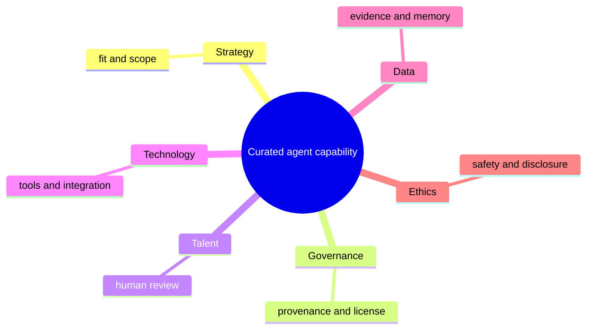

# Awesome Motion Design Agent Skills [](https://awesome.re)

<!-- fleet:hero:start -->
<p align="center"></p>
<!-- fleet:hero:end -->

[](https://github.com/tarouco/motion-design-agent-skills) [](https://github.com/tarouco/motion-design-agent-skills/commits/main) [](LICENSE)

<!-- fleet:install-badges:start -->

[](#install) [](https://code.claude.com/docs/en/discover-plugins) [](https://github.com/tarouco/motion-design-agent-skills/releases/tag/skills-latest)

<!-- fleet:install-badges:end -->

> One installable plugin, `motion-design-agent-skills`: an orchestrator, five `SKILL.md` motion workflows and the official GSAP and LottieFiles references for Claude Code, Claude.ai, Cowork, Codex, Antigravity and Hermes Agent, plus a curated catalog of GSAP, Motion, Remotion, Rive, Lottie and 3D tools.

Fork of [frankxai/awesome-motion-design-agent-skills](https://github.com/frankxai/awesome-motion-design-agent-skills) (CC0-1.0), packaged as a single plugin. Plugin guide: [PLUGIN.md](PLUGIN.md) · [guia em português](docs/plugin-guide.pt-BR.md).

Every entry links to its primary source and carries a dated pulse. Companion FrankX lists sit at the end, never in front.

**Doctrine:** static hierarchy first. Animate only to clarify state or narrative. Design the reduced-motion path — don't just disable it. Verify on real devices.

<!-- fleet:install:start -->

## Install

Fifteen skills ship in [`skills/`](skills) as open-standard `SKILL.md` folders and as **one plugin** named `motion-design-agent-skills`: the orchestrator, five first-party workflows and nine vendored MIT references (GSAP, LottieFiles). Manifests for every host live side by side: [`.claude-plugin/`](.claude-plugin/plugin.json), [`plugin.json`](plugin.json) (Codex and portable hosts), [`.antigravity-plugin/`](.antigravity-plugin/plugin.json) and [`.agents/plugins/marketplace.json`](.agents/plugins/marketplace.json).

| Surface                               | Install command                                                                                                                                                                                                   | Result                                                |
| ------------------------------------- | ----------------------------------------------------------------------------------------------------------------------------------------------------------------------------------------------------------------- | ----------------------------------------------------- |
| **Claude Code** plugin                | `/plugin marketplace add tarouco/motion-design-agent-skills` then `/plugin install motion-design-agent-skills@tarouco-motion`                                                                                     | Plugin with 15 skills and a SessionStart routing hook |
| **Claude Code** (one step, v2.1.275+) | `/plugin install motion-design-agent-skills --marketplace tarouco/motion-design-agent-skills`                                                                                                                     | Same plugin                                           |
| **Claude.ai · Cowork**                | Download [`motion-design-agent-skills.zip`](https://github.com/tarouco/motion-design-agent-skills/releases/download/skills-latest/motion-design-agent-skills.zip), then Customize > Plugins > Add > Upload plugin | Uploaded plugin, also synced to Claude Code           |
| **Codex**                             | `codex plugin marketplace add tarouco/motion-design-agent-skills` then `codex plugin add motion-design-agent-skills@tarouco-motion`                                                                               | Codex plugin                                          |
| **Codex** (skills only)               | `npx --yes skills add tarouco/motion-design-agent-skills -a codex -g -y`                                                                                                                                          | `~/.agents/skills/<name>/SKILL.md`                    |
| **Antigravity**                       | `agy plugin install https://github.com/tarouco/motion-design-agent-skills`                                                                                                                                        | Plugin with an always-on routing rule                 |
| **Antigravity** (skills only)         | `npx --yes skills add tarouco/motion-design-agent-skills -a antigravity -g -y`                                                                                                                                    | `~/.gemini/config/skills/<name>/SKILL.md`             |
| **Hermes Agent**                      | `npx --yes skills add tarouco/motion-design-agent-skills -a hermes-agent -g -y`                                                                                                                                   | `~/.hermes/skills/<name>/SKILL.md`                    |
| **All agents + memory**               | `./install.sh --agent all --with-remotion` from a clone                                                                                                                                                           | Plugin/skills, routing memory, Remotion skills        |

Verify on a fresh checkout:

```bash
npx --yes skills add tarouco/motion-design-agent-skills --list
claude plugin validate .
python3 scripts/verify-repo.py
./install.sh --check-deps
```

The installer writes the routing memory block ([`memory/motion-design-routing.md`](memory/motion-design-routing.md)) into `~/.claude/CLAUDE.md`, `~/.codex/AGENTS.md` and `~/.gemini/GEMINI.md`; Claude.ai and Hermes memory steps are in [`memory/`](memory/claude-ai.pt-BR.md). Scan any third-party pack with `NVIDIA/SkillSpector` before it reaches a live profile.

<!-- fleet:install:end -->

## Choose your workflow

One orchestrator plus five first-party skills, one per job. The orchestrator picks the skill for you; read the `SKILL.md` to call one directly.

| Job                                                 | Skill                                                                                | Companion spec / rubric                                                                                                                                 | Zip                                                                                                                            |
| --------------------------------------------------- | ------------------------------------------------------------------------------------ | ------------------------------------------------------------------------------------------------------------------------------------------------------- | ------------------------------------------------------------------------------------------------------------------------------ |
| Route any motion request, run multi-stage pipelines | [`motion-design-orchestrator`](skills/motion-design-orchestrator/SKILL.md)           | [pipelines](skills/motion-design-orchestrator/references/pipelines.md) · [skill catalog](skills/motion-design-orchestrator/references/skill-catalog.md) | [↓](https://github.com/tarouco/motion-design-agent-skills/releases/download/skills-latest/motion-design-orchestrator.zip)      |
| Product UI motion, stack choice, vector/3D assets   | [`motion-director`](skills/motion-director/SKILL.md)                                 | [motion quality rubric](rubrics/motion-quality-rubric.md)                                                                                               | [↓](https://github.com/tarouco/motion-design-agent-skills/releases/download/skills-latest/motion-director.zip)                 |
| Cinematic site choreography                         | [`site-motion-excellence-director`](skills/site-motion-excellence-director/SKILL.md) | [site motion spec](templates/site-motion/SITE_MOTION_SPEC.md) · [excellence gate](rubrics/site-motion-excellence-gate.md)                               | [↓](https://github.com/tarouco/motion-design-agent-skills/releases/download/skills-latest/site-motion-excellence-director.zip) |
| Deterministic video in React                        | [`remotion-video-agent`](skills/remotion-video-agent/SKILL.md)                       | [GIF/video pipeline](playbooks/gif-video-pipeline.md)                                                                                                   | [↓](https://github.com/tarouco/motion-design-agent-skills/releases/download/skills-latest/remotion-video-agent.zip)            |
| Generative media routing and finishing              | [`generative-media-director`](skills/generative-media-director/SKILL.md)             | [production workflow](playbooks/image-video-gif-production-workflow.md) · [provider routing](playbooks/video-provider-routing.md)                       | [↓](https://github.com/tarouco/motion-design-agent-skills/releases/download/skills-latest/generative-media-director.zip)       |
| Review, capture, motion QA                          | [`web-motion-auditor`](skills/web-motion-auditor/SKILL.md)                           | [site motion rollout](playbooks/site-motion-rollout.md)                                                                                                 | [↓](https://github.com/tarouco/motion-design-agent-skills/releases/download/skills-latest/web-motion-auditor.zip)              |

Bundled references: `gsap-core`, `gsap-timeline`, `gsap-scrolltrigger`, `gsap-plugins`, `gsap-react`, `gsap-frameworks`, `gsap-utils`, `gsap-performance` (greensock/gsap-skills, MIT) and `motion-design` (LottieFiles/motion-design-skill, MIT). See [THIRD_PARTY_NOTICES.md](THIRD_PARTY_NOTICES.md).

New here? [GETTING_STARTED](GETTING_STARTED.md) walks discovery → read → install → verify.

<details>
<summary>Everything else in the repo</summary>

| Layer     | Files                                                                                                                                                                                                                                                                                   |
| --------- | --------------------------------------------------------------------------------------------------------------------------------------------------------------------------------------------------------------------------------------------------------------------------------------- |
| Templates | [`MOTION.md` brand motion](templates/brand-motion/MOTION.md) · [media brief](templates/creative-briefs/motion-media-brief.md)                                                                                                                                                           |
| Playbooks | [recommended installs](playbooks/recommended-installs.md)                                                                                                                                                                                                                               |
| Contracts | [media job schema](schemas/media-job.schema.json) · [provider routing config](configs/provider-routing.default.json) · [motion pattern registry](patterns/motion-pattern-registry.json)                                                                                                 |
| Maps      | [motion capability matrix](capabilities/motion-capability-matrix.md) · [generative media provider matrix](capabilities/generative-media-provider-matrix-2026-06-22.md) · [Motion Designer MCP spec](mcp/motion-designer-mcp.md) · [stack ranking](rankings/best-motion-design-stack.md) |

</details>

<!-- earned-skill-index:2026-09-28 -->

## Earned third-party skill packs

Operators get leverage from **about 5–7 named workflows**, not bulk dumps. Method: [earned-skills index](https://github.com/frankxai/awesome-hermes-agent-skills/blob/main/docs/EARNED-SKILLS.md) · [safety gate](https://github.com/frankxai/awesome-hermes-agent-skills/blob/main/docs/QUALITY-AND-SAFETY.md).

| Pack                                                                                  | Pulse               | Job                                                          | Install                                          |
| ------------------------------------------------------------------------------------- | ------------------- | ------------------------------------------------------------ | ------------------------------------------------ |
| [greensock/gsap-skills](https://github.com/greensock/gsap-skills)                     | MIT · 15.8k★        | Official GSAP agent skills — timelines, ScrollTrigger, React | `npx skills add greensock/gsap-skills`           |
| [remotion-dev/skills](https://github.com/remotion-dev/skills)                         | 4.8k★               | Official Remotion agent skills                               | `npx skills add remotion-dev/skills`             |
| [LottieFiles/motion-design-skill](https://github.com/LottieFiles/motion-design-skill) | MIT · 1.8k★         | Motion-design principles for Lottie / dotLottie output       | `npx skills add LottieFiles/motion-design-skill` |
| [Orkas-AI/Orkas-VideoStudio](https://github.com/Orkas-AI/Orkas-VideoStudio)           | MIT · 496★          | 14-skill video pack driven by `plan.json`                    | see repo                                         |
| [garrytan/gstack](https://github.com/garrytan/gstack)                                 | MIT · 134k★         | Design / motion QA passes                                    | see repo                                         |
| [nexu-io/open-design](https://github.com/nexu-io/open-design)                         | Apache-2.0 · 98k★   | Design + media workflows, Hermes via ACP                     | see repo                                         |
| [NVIDIA/SkillSpector](https://github.com/NVIDIA/SkillSpector)                         | Apache-2.0 · 18.5k★ | Scan skill packs before install                              | see repo                                         |

Do not install unsigned ZIP/S3 skill blobs or mass-dump skill collections into a live profile.

## Curated catalog

| Project                                                                                                     | Pulse snapshot                                                | Why it is here                                                                                                                                                                                                                                                                                                              |
| ----------------------------------------------------------------------------------------------------------- | ------------------------------------------------------------- | --------------------------------------------------------------------------------------------------------------------------------------------------------------------------------------------------------------------------------------------------------------------------------------------------------------------------- |
| [GSAP](https://github.com/greensock/GSAP)                                                                   | Custom license · 28.7k★                                       | Timeline-grade JavaScript animation; ScrollTrigger for narrative scroll.                                                                                                                                                                                                                                                    |
| [Motion](https://github.com/motiondivision/motion)                                                          | MIT · 33.8k★                                                  | React/JavaScript animation with layout and gesture primitives.                                                                                                                                                                                                                                                              |
| [React Three Fiber](https://github.com/pmndrs/react-three-fiber)                                            | MIT · 32.6k★                                                  | Three.js as a React renderer for 3D scenes with fallbacks.                                                                                                                                                                                                                                                                  |
| [Remotion](https://github.com/remotion-dev/remotion)                                                        | Custom license · 60.9k★                                       | Programmatic video rendered from React.                                                                                                                                                                                                                                                                                     |
| [Anime.js](https://github.com/juliangarnier/anime)                                                          | MIT · 73.2k★                                                  | Lightweight timeline animation for DOM, SVG and CSS.                                                                                                                                                                                                                                                                        |
| [Effect Atlas](https://effectatlas.com)                                                                     | Custom license · checked 2026-11-03                           | A free library of 50+ web motion effects (cursor, hover, scroll, transitions) in plain HTML/CSS/JS, each with AI-readable notes so coding agents can drop them into a project.                                                                                                                                              |
| [Rive WebAssembly](https://github.com/rive-app/rive-wasm)                                                   | MIT · 970★                                                    | State-machine interactive vector animation runtime.                                                                                                                                                                                                                                                                         |
| [dotLottie web](https://github.com/LottieFiles/dotlottie-web)                                               | MIT · 888★                                                    | Modern Lottie player for web UI motion assets.                                                                                                                                                                                                                                                                              |
| [Phaser](https://github.com/phaserjs/phaser)                                                                | MIT · 40.4k★                                                  | Real-time web interaction and game-feel patterns.                                                                                                                                                                                                                                                                           |
| [1human reference client](https://github.com/mdagnolops/1human-reels)                                       | MIT client · checked 2026-10-10                               | Discover attributed motion references and retrieve recipes with owner-authorized agent access.                                                                                                                                                                                                                              |
| [Agent Skills](https://github.com/agentskills/agentskills)                                                  | Apache-2.0 · 25.8k★                                           | The open `SKILL.md` standard these skills follow.                                                                                                                                                                                                                                                                           |
| [skills CLI](https://github.com/vercel-labs/skills)                                                         | MIT · 32.7k★                                                  | Cross-agent installer behind `npx skills add`.                                                                                                                                                                                                                                                                              |
| [product-launch-motion](https://github.com/AbubakrChan/product-launch-motion)                               | MIT · 253★                                                    | Claude Code skill: website URL to a 60 fps launch video with music, SFX and motion blur. Needs local Playwright and ffmpeg.                                                                                                                                                                                                 |
| [launch-film](https://github.com/EminBudak/launch-film)                                                     | MIT · 0★                                                      | Agent skill: a website or App Store link to a 20 to 40 second launch film made from the site's own logo files, colors and headline. Needs local Chrome and ffmpeg.                                                                                                                                                          |
| [lookbk-skills](https://github.com/SHARPLEE00/lookbk-skills)                                                | MIT · checked 2026-11-05                                      | Eight `SKILL.md` skills that render locally, including a kinetic title video and an 8-bit promo built on HyperFrames and GSAP. No AI model or API key needed.                                                                                                                                                               |
| [DESIGN:OS SVG Animation](https://github.com/jangtrinh/design-os-svg-animation)                             | PolyForm Shield 1.0.0 (source-available) · checked 2026-11-08 | Free agent skill + CLI for deterministic SVG motion on an integer-frame virtual clock, compiled to 1080p 60 fps video and checked by a 10-gate verifier. Runs locally, zero telemetry.                                                                                                                                      |
| [vawe](https://github.com/Vandit1604/vawe)                                                                  | Apache-2.0 · 7★                                               | Render one HTML page (CSS, Web Animations, SVG, canvas, three.js) to a deterministic MP4 in headless Chrome. Ships agent skills.                                                                                                                                                                                            |
| [AgentsUses: Motion Graphics](https://agentsuses.com/c/motion-graphics/)                                    | Free website · entries re-checked on a schedule               | Picks a motion skill before you install it: each entry links the source repo and shows its licence, install path, a starter prompt, an automated safety-scan note and, where available, credited result videos.                                                                                                             |
| [pro-motion](https://github.com/jack-reson8/pro-motion)                                                     | MIT · 0★                                                      | Audio-first skill that plans the music, then renders a motion-graphics launch or brand film in code (canvas to MP4) cut to the track. Needs local Node, Chrome and ffmpeg.                                                                                                                                                  |
| [Launchscene MCP](https://launchscene.app/mcp)                                                              | Hosted MCP · checked 2026-10-28                               | Search 1,100+ tech launch videos scene by scene with measured timing, on-screen text, camera and sound, then export Remotion or HyperFrames starters. OAuth account, free in beta; references stay their brands’ property.                                                                                                  |
| [Comment-to-DM box](https://github.com/commentkeyword/instagram-mcp-server/tree/main/integrations/remotion) | MIT · checked 2026-11-02                                      | Remotion end card for Reels: an Instagram comment box types the keyword, shows the reply, then swipes to the DM. Plain props, no account.                                                                                                                                                                                   |
| [Valmera MCP](https://github.com/ABO3SKRALMASAOODI/valmera-mcp)                                             | MIT · checked 2026-11-06                                      | Three agent skills for footage edits, shorts and recorded website demos through a hosted MCP service. Review a rendered preview before export.                                                                                                                                                                              |
| [Motion Agent](https://github.com/itswenxin/motion-agent)                                                   | MIT · checked 2026-11-06                                      | Drives Adobe After Effects from Claude Code or Codex through a local file bridge: native editable layers, Bézier-eased keyframes, recreate-from-link with frame-by-frame checks, 12 verified recipes. Needs macOS and After Effects.                                                                                        |
| [tech-to-motion](https://github.com/georgesmomo/tech-to-motion)                                             | MIT · 0★                                                      | Agent skill: real technical sources (docker-compose, Kubernetes, Terraform, CI workflows, postmortems) to a ByteByteGo-style explainer video with animated architecture diagrams and synthesised SFX, checked by safe-area and still-frame QA before render. Built on HyperFrames and GSAP; needs Node 22 and local Chrome. |
| [idea-to-motion](https://github.com/georgesmomo/idea-to-motion)                                             | MIT · 0★                                                      | Agent skill: any idea to a motion-design MP4. Asks up to 3 questions only when the brief is incomplete, 14 styles with their own motion character, procedural music on a beat grid, synthesised SFX, local voice-over with captions. Built on HyperFrames and GSAP; needs Node 22 and local Chrome.                         |

The 1human client serves reference discovery rather than rendering: [public previews](https://reels.1human.tech/) need no account, while recipes, publication and private preferences require owner-approved credentials. The client/examples are MIT; the hosted service, brand and private data are not. Reference licenses remain per creation. Basic participation is free, with a capped beta; this is not a universal importer or evidence of adoption.

Valmera’s [website-demo skill](https://github.com/ABO3SKRALMASAOODI/valmera-mcp/blob/main/skills/website-demo-video/SKILL.md) covers public visitor flows or approved screen recordings. Editing runs on the hosted service and requires authentication and a paid plan; the MIT license covers the plugin and skill source, not the hosted editor. The skills require an approved scope before billable work and a reviewed preview before final export. [Worked trim-and-reframe export](https://valmera.io/examples/trim-and-reframe) · [current release](https://github.com/ABO3SKRALMASAOODI/valmera-mcp/releases/tag/claude-v1.0.2).

<details>
<summary>Editorial curation lens (optional)</summary>



This lens is editorial, not an endorsement or a claim that a project satisfies every pillar.

</details>

<!-- fleet:ecosystem:start -->

## Explore the FrankX Awesome Ecosystem

Companion catalogs. The third-party projects above are this list's primary value.

**Agents & systems** — [agent operating systems](https://github.com/frankxai/awesome-agent-operating-systems) · [hermes agents](https://github.com/frankxai/awesome-hermes-agents) · [hermes agent skills](https://github.com/frankxai/awesome-hermes-agent-skills) · [automation](https://github.com/frankxai/awesome-automation-agent-skills) · [AI CoE](https://github.com/frankxai/awesome-ai-coe)

**Create** — [design](https://github.com/frankxai/awesome-design-agent-skills) · **motion design** · [music](https://github.com/frankxai/awesome-music-agent-skills) · [gamification](https://github.com/frankxai/awesome-gamification-agent-skills)

**Capital** — [agentic income](https://github.com/frankxai/awesome-agentic-income) · [investor](https://github.com/frankxai/awesome-investor-agent-skills) · [wealth](https://github.com/frankxai/awesome-wealth-agent-skills) · [payments](https://github.com/frankxai/awesome-payment-agent-skills)

**Mind & cosmos** — [mind](https://github.com/frankxai/awesome-mind-agent-skills) · [manifestation](https://github.com/frankxai/awesome-manifestation-skills) · [cosmos](https://github.com/frankxai/awesome-cosmos-ai-agents)

<!-- fleet:ecosystem:end -->

## Contribution standard

See [CONTRIBUTING.md](CONTRIBUTING.md) for the full pull-request checklist. Open a PR with a primary URL, one-sentence distinct value, current maintenance evidence, license posture, and relevant safety or reduced-motion caveat. New skills must pass `skills-validate` (frontmatter `name` matches folder, `description` ≤ 1024 chars, no private paths) and fresh-checkout installation in Claude Code and Codex.

## Research method

Repository metadata (stars, SPDX license, archived state, last push) was pulled from the GitHub API on **2026-10-24**. "Custom license" means GitHub returned no standard SPDX identifier — read the license before adoption. Counts are dated discovery signals, not rankings. Links are checked on every PR and monthly by [Lychee](.github/workflows/link-checker.yml). Nothing here is financial, legal, medical, or safety advice.
